## Acerca de Mí

Soy un ingeniero de software con más de 4 años de experiencia en el diseño de arquitecturas resilientes y en la implementación de soluciones backend.

Cuento con sólidos conocimientos en lenguajes de programación orientados a la lógica de negocio, el diseño de bases de datos, la integración de servicios en la nube y la configuración de contenedores.

Dedico parte de mi tiempo a la mentoría técnica, acompañando de forma directa a colegas en formación y contribuyendo así a la democratización del conocimiento en tecnología.

## Habilidades

Las siguientes son las tecnologías y los enfoques que conforman mi perfil técnico.

<b>Lenguajes y Frameworks</b>

 

<samp>LENGUAJES</samp> 
<code>Go</code> <code>Java</code> <code>Python</code> <code>JavaScript</code> <code>PHP</code>

<samp>FRAMEWORKS</samp> 
<code>Spring&nbsp;Boot</code> <code>FastAPI</code> <code>Express.js</code> <code>Laravel</code>

<b>Arquitectura e Integración</b>

 

<samp>ARQUITECTURA</samp> 
<code>Microservicios</code> <code>Domain&#8209;Driven&nbsp;Design</code> <code>Event&#8209;Driven</code> <code>CQRS</code> <code>Event&nbsp;Sourcing</code>

<samp>INTEGRACIÓN Y MENSAJERÍA</samp> 
<code>REST</code> <code>gRPC</code> <code>RabbitMQ</code> <code>OpenAPI</code>

<b>Datos y Cloud</b>

 

<samp>BASES DE DATOS</samp> 
<code>PostgreSQL</code> <code>Oracle&nbsp;Database</code> <code>MySQL</code> <code>MariaDB</code> <code>MongoDB</code> <code>ScyllaDB</code> <code>Redis</code>

<samp>CLOUD</samp> 
<code>Amazon&nbsp;EC2</code> <code>Amazon&nbsp;S3</code> <code>AWS&nbsp;Lambda</code> <code>Amazon&nbsp;Cognito</code> <code>Amazon&nbsp;SNS</code> <code>Amazon&nbsp;SES</code>

<b>DevOps y Observabilidad</b>

 

<samp>DEVOPS Y CI/CD</samp> 
<code>Docker</code> <code>GitLab&nbsp;CI/CD</code> <code>SonarQube</code>

<samp>OBSERVABILIDAD</samp> 
<code>OpenTelemetry</code> <code>Grafana</code> <code>Tempo</code>

## Bóveda

Los siguientes son proyectos que he desarrollado y cuyo código fuente se conserva en repositorios privados. Si alguno resulta de su interés, será un gusto conversar sobre el acceso.

<b>Inteligencia Artificial y Datos</b>

 

<table>
<tr>
<th width="12%">CÓDIGO</th>
<th width="88%" align="left">PROYECTO</th>
</tr>
<tr>
<td align="center"><code>IA&#8209;01</code></td>
<td><b>Supply Chain Forecast</b> Modelos de predicción y pronóstico sobre series de tiempo para anticipar la demanda y optimizar la cadena de producción de la industria farmacéutica.</td>
</tr>
<tr>
<td align="center"><code>IA&#8209;02</code></td>
<td><b>A.I. Master Checkers</b> Juego de damas inglesas con un oponente artificial que razona sus jugadas mediante el algoritmo <i>Minimax</i>, optimizado con tablas de transposición.</td>
</tr>
<tr>
<td align="center"><code>IA&#8209;03</code></td>
<td><b>Hydrological Monitoring</b> Herramienta de escritorio para el monitoreo hidrológico. Aplica el método de expansión de Taylor para estimar y ofrecer información sobre diversas variables hídricas.</td>
</tr>
<tr>
<td align="center"><code>IA&#8209;04</code></td>
<td><b>Gota Scanner</b> Aplicación móvil que, a partir de una fotografía, detecta enfermedades en cultivos de papa, como el tizón tardío, para apoyar decisiones tempranas en el campo.</td>
</tr>
</table>

<b>Salud y Bienestar</b>

 

<table>
<tr>
<th width="12%">CÓDIGO</th>
<th width="88%" align="left">PROYECTO</th>
</tr>
<tr>
<td align="center"><code>SB&#8209;01</code></td>
<td><b>Suamox Medical</b> Plataforma web de consulta de síntomas, orientación diagnóstica y prevención de enfermedades.</td>
</tr>
<tr>
<td align="center"><code>SB&#8209;02</code></td>
<td><b>Drugstore</b> Aplicación web para administrar los procesos operativos de una droguería: productos, inventario y atención al cliente.</td>
</tr>
<tr>
<td align="center"><code>SB&#8209;03</code></td>
<td><b>Vida Sana</b> Plataforma web orientada al bienestar que promueve y acompaña hábitos de vida saludables.</td>
</tr>
</table>

<b>Negocios y Servicios</b>

 

<table>
<tr>
<th width="12%">CÓDIGO</th>
<th width="88%" align="left">PROYECTO</th>
</tr>
<tr>
<td align="center"><code>NS&#8209;01</code></td>
<td><b>SelloDoc</b> Aplicación de sellado automático de reportes y documentos que agiliza su validación y reduce el trabajo manual.</td>
</tr>
<tr>
<td align="center"><code>NS&#8209;02</code></td>
<td><b>Gestión de Restaurante</b> Plataforma para restaurantes que centraliza la toma de pedidos, las reservas de mesas y la administración del menú.</td>
</tr>
<tr>
<td align="center"><code>NS&#8209;03</code></td>
<td><b>Tienda de Moda</b> Tienda en línea de ropa con catálogo de productos, carrito de compras y gestión de pedidos.</td>
</tr>
<tr>
<td align="center"><code>NS&#8209;04</code></td>
<td><b>Servicios Notariales</b> Plataforma para notarías que permite publicar sus servicios, recibir solicitudes de trámites y mantener informados a los usuarios.</td>
</tr>
<tr>
<td align="center"><code>NS&#8209;05</code></td>
<td><b>Dog Training</b> Aplicación de agendamiento y solicitud de citas para el entrenamiento de mascotas.</td>
</tr>
</table>

<b>Plataformas Web y Producto</b>

 

<table>
<tr>
<th width="12%">CÓDIGO</th>
<th width="88%" align="left">PROYECTO</th>
</tr>
<tr>
<td align="center"><code>PW&#8209;01</code></td>
<td><b>Clon de Plataforma Musical</b> Plataforma de <i>streaming</i> musical que permite explorar artistas y álbumes, buscar canciones, reproducirlas en línea y organizarlas en listas de reproducción, sobre un backend independiente que gestiona el catálogo y los usuarios.</td>
</tr>
<tr>
<td align="center"><code>PW&#8209;02</code></td>
<td><b>Prototipo de Red Social</b> Red social centrada en contenido visual: perfiles de usuario, publicación de fotografías, un <i>feed</i> con las publicaciones de las cuentas seguidas e interacción mediante reacciones y comentarios, respaldada por servicios backend propios.</td>
</tr>
</table>

## Contacto

¿Le interesa algún proyecto, una colaboración o una mentoría? Suelo responder en menos de 8&nbsp;horas. También puede encontrarme en los siguientes canales:

